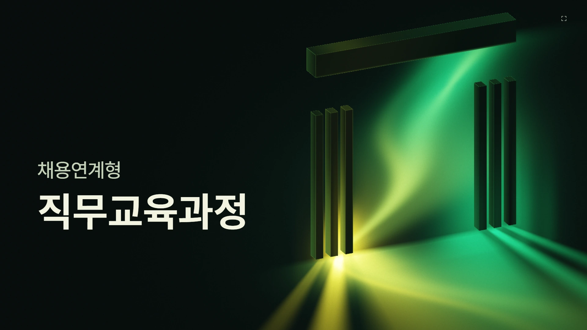

# 채용연계형 직무교육과정

Vue와 fullPage.js로 만든 1920×1080 발표 표지다. 기본 표지와 세 가지 예시 모두 ‘채용연계형’과 ‘직무교육과정’만 사용한다.

## 기본 표지의 아트디렉션

작은 노란 광원을 왼쪽 기둥 안쪽에 두고, 오른쪽에서 넓게 들어오는 초록빛과 겹쳤다. 두 광원의 밝기를 따로 계산해 빛이 접히는 부분은 연두색으로 모이고, 바닥에 닿는 부분은 에메랄드색으로 풀린다. 흰색에 가까운 가장 밝은 지점은 한 곳에만 두었다.

세종문화회관의 심볼 SVG가 구조물의 앞면을 결정한다. 이 표지를 위해 입체 투영, 금속 표면, 빛의 굴절과 확산, 한글 조판 및 반응형 웹 렌더링을 제작했다. 위 이미지는 브라우저에서 실행한 화면의 캡처다. [원본 심볼](세종문화회관심볼.svg) · [세종문화회관 CI 설명](https://www.sejongpac.or.kr/portal/main/contents.do?menuNo=200508)

## 표지와 시안

| 주소 | 구성 |
| --- | --- |
| [기본 표지 · 빛의 파사드](http://127.0.0.1:5173/) | 짙은 녹흑색 무대에서 여섯 기둥 사이로 나온 노란빛이 접히며 초록빛에 스며든다. |
| [겹친 인쇄면](http://127.0.0.1:5173/?study=imprint) | 옅은 종이색 위에 하나의 판을 청색과 남색으로 두 번 찍는다. 겹친 자리에서만 두 선의 결이 만나며, 제목은 왼쪽 아래 여백에 두 줄로 놓인다. |
| [입체 고리](http://127.0.0.1:5173/?study=link) | 가는 홈이 파인 밝은 고리와 매끈한 파란 고리가 서로 통과한다. 짙은 바탕에 ‘직무교육과정’을 크게 놓아 두 문구에 위계를 준다. |
| [한글 획](http://127.0.0.1:5173/?study=type) | 한글 ‘ㅇ’의 속공간을 확대해 화면 밖까지 이어지는 획을 만든다. 세로 조판한 ‘채용연계형’과 굵은 가로 제목이 서로 다른 축을 잡는다. |

가로 화면에서는 제목이 무대 왼쪽에, 세로 화면에서는 무대 아래에 놓인다. 모든 그래픽은 코드로 그린 정지 화면이다.

## 참고 작업

- 한 장의 인쇄물이 바탕색, 배치 각도, 여백에 따라 어떻게 다르게 읽히는지 비교했다. [SAM의 STILLNESS](https://kr.pinterest.com/pin/501588477274468996/)
- 한글의 굵기와 줄바꿈 자체로 포스터의 구도를 만드는 방식을 살폈다. [슬기와 민의 광주비엔날레 2014 포스터](https://www.sulki-min.com/wp/gwangju-biennale-2014-posters/)
- 공연마다 다른 색과 형태를 주면서 간결한 타이포그래피로 시리즈를 묶는 방식을 참고했다. [FAY의 so&so](https://fay.design/work/so-and-so/)

## 실행

`npm install` 후 `npm run dev`로 로컬 서버를 연다. 배포용 파일은 `npm run build`로 생성한다.
